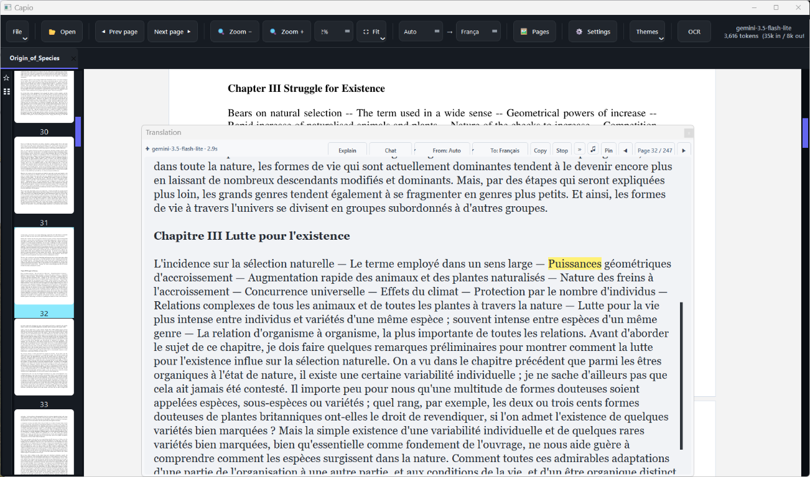
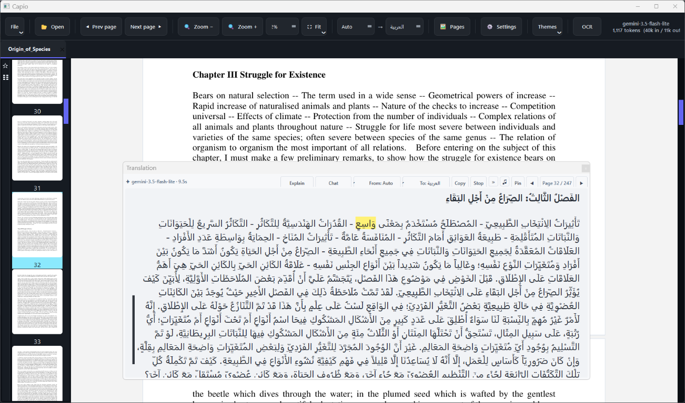
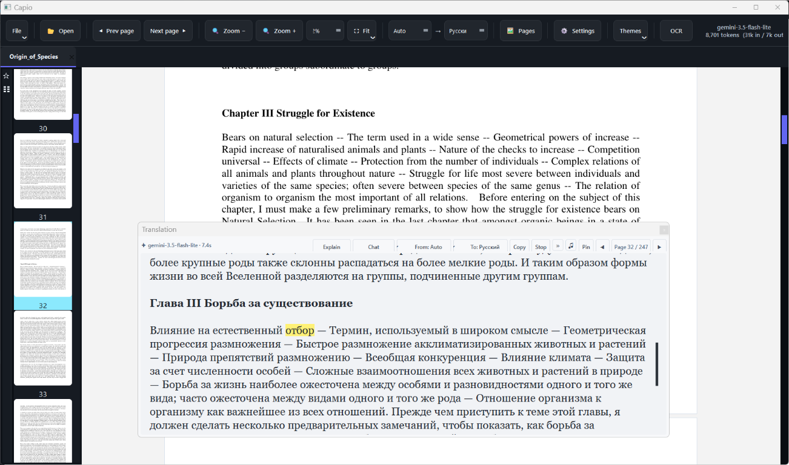

# Capio

**Translate. Understand. Listen.**
Your AI reading companion, right inside your book.

Read books in other languages without leaving the page to take screenshots,
switch apps, and paste text into an AI chat. Select a word or passage to see
its translation alongside the book, ask for an explanation, or listen while
the current words are highlighted.

Learn more about the idea behind Capio in [Why Capio?](WHY_CAPIO.md).

The screenshot files are next to this README in the project folder, so you can
open them directly without searching through subfolders.

## See Capio in action

<table>
  <tr>
    <td></td>
    <td></td>
  </tr>
  <tr>
    <td align="center"><sub>Translate a passage into French without leaving the book.</sub></td>
    <td align="center"><sub>Read an Arabic translation alongside the original page.</sub></td>
  </tr>
  <tr>
    <td></td>
    <td></td>
  </tr>
  <tr>
    <td align="center"><sub>Switch target languages while keeping your place.</sub></td>
    <td align="center"><sub>Use the floating translator on a website or another desktop app.</sub></td>
  </tr>
</table>

## Quick start (Windows)

1. Install **Python 3.10 or newer** for Windows.
2. Download and extract the Capio project.
3. Double-click **`run.bat`** for the book reader or **`run_float.bat`** for
   the floating translator.

On first launch, Capio creates a private Python environment and downloads the
required libraries. This can take several minutes and requires an internet
connection. Later launches reuse the installation. You do not need to install
the libraries yourself. Translation requires choosing a provider; some
providers work without an API key, while others need your own key.

For a simple walkthrough, see the [Easy Start Guide](START_HERE.md).

## Features

- **Translate inside the book:** select a word or passage and read the result
  beside the original page.
- **Translate outside the reader:** use the floating translator to select a
  screen area and read its text with OCR, or send the image to a model that
  supports vision.
- **Read scans and images:** use OCR on scanned pages, or send a selected
  image directly to a model that supports vision.
- **Understand as you read:** ask AI for an explanation of a passage.
- **Listen and follow along:** hear translations with word-by-word highlighting;
  stop and resume from where playback left off.
- **For books across subjects:** literature, history, programming, mathematics,
  science, music, and more. Code and equations keep their proper form; music
  formatting is applied only when the source is clearly about music.
- **Open common formats:** PDF, EPUB, DOCX, TXT, Markdown, HTML, XPS/OXPS, FB2,
  CBZ, and common image files.

## Full guide

The sections below cover supported documents, translation providers, settings,
OCR and image translation, speech, troubleshooting, and optional packaging.

### Supported documents and page reading

Capio supports PDF, EPUB, DOCX, TXT, Markdown, HTML, XPS/OXPS, FB2, CBZ comics,
and common image formats (PNG, JPEG, BMP, GIF, TIFF, WebP, and SVG).
Non-PDF documents are rendered to temporary pages for reading and translation;
the original file is kept unchanged until saved. TXT and Markdown files can be
edited from **File → Edit source text** and saved in their original format with
**Save** (Ctrl+S); hold Ctrl and scroll over the editor to enlarge or reduce
the source font. The source editor uses a light background and opens at 18 px.
Markdown is edited as source, while the reader view renders its formatting.
Other non-PDF formats remain read-only; use **Save as PDF** to export a copy.
PDF editing and in-place saving continue to work as before.

### OCR and direct image translation

Works on **both** kinds of PDFs:
- **Text PDFs** — instant translation of the selected text.
- **Scanned-image PDFs** — OCR reads the selected area first, using the
  **native OneOCR engine** (Snipping Tool's) on Windows 11; OneOCR detects
  supported languages automatically, so there is no bundled third-party OCR
  fallback to install and no language list to configure.
- **Direct image translation** — choose **Settings → Application → Selection
  reading → Send selection image to vision model** to send the selected page
  area directly to the selected model, without local OCR. Gemini, OpenCode
  bridge/Zen, and OpenAI-compatible vision endpoints use their native image
  request formats. The selected model must support images; unsupported models
  report their provider error. Image mode always sends the rendered selection
  to the vision model, even when the PDF also has a text layer. OCR mode remains
  the default.
- **Hybrid scans** — some PDFs contain a scanned page image plus a small,
  incomplete hidden text layer. Full-page translation detects a large page
  image with sparse text and OCRs the rendered page instead of translating
  only that partial text layer.

## Translation providers (API keys are optional)

1. **Gemini Flash:** get an API key from
   https://aistudio.google.com/apikey → ⚙ Settings → API Keys tab → paste → Save.
   Available models, quotas, and pricing depend on your Google account and plan.
2. **FreeLLMAPI:** a local router you
   run on your own machine. It stacks dozens of free providers behind one
   OpenAI-compatible `/v1` endpoint and **fails over between them on its own**,
   so a rate-limited upstream never reaches this app. Start the router, copy
   the unified key from its Keys page → ⚙ Settings → API Keys → FreeLLMAPI.
   The router URL is read from the router's own `config.json`, so the port is
   never guessed. In the picker you get `auto`, `auto:fast`, `auto:smart`,
   `auto:reliable`, `auto:balanced`, `fusion`, plus every model currently `ready`.
   Two things make it honest rather than a black box: the badge names the
   engine that actually answered (`🔀 groq/qwen/qwen3.8-27b`), read from the
   gateway's `X-Routed-Via` header, and a stream names it too — the badge comes
   from the streamed response, never a second request. `auto` also handles
   image translation, because the router routes images to a vision model
   itself. Measured here: `auto:fast` 2.4s, `auto` 4.5s.
3. **OpenCode bridge free, no key needed:** eight free models that answer
   through an in-process streaming bridge (`translators/opencode_bridge.py`),
   ordered fastest-first by measurement:
   `space-bunny-free` (3.4s) · `muse-spark-1.3-contributor-free` (4.3s) ·
   `mimo-v2.6-flash-free` (5.5s) · `fledge-alpha-free` (6.0s) ·
   `muse-spark-1.2-contributor-free` · `longcat-2.5-preview-free` ·
   `nemotron-3.5-lightning-free` · `nemotron-3-ultra-free`.
   The bridge uses streaming SSE plus the OpenCode client fingerprint
   (`stream:true` + shell/read tools + `opencode/` User-Agent + session id);
   without it the free tier answers 403. Muse-spark ids go through the
   `/responses` endpoint, the rest through `/chat/completions`. No API key
   field is offered and dead `-free` ids are not listed: a model that cannot
   answer only costs you a failed translation.
4. **Pick ONE free model** in ⚙ Settings → Translation tab, grouped so
   you always know what costs what:
   ✦ Gemini (free) · 🔀 FreeLLMAPI (your router) · 🌉 OpenCode bridge free
   (no key) · 🌐 Google Translate (unofficial, no key).
   Models that failed verification stay visible but disabled, so you can see
   why instead of discovering it mid-sentence.
5. **Custom providers (optional):** add an OpenAI-compatible endpoint in
   **Settings → Custom Providers**. After Base URL + API Key are entered, its
   `/v1/models` list is fetched automatically and appears in the Model menu.
   The **Reasoning** option controls reasoning on supported endpoints (for
   Ollama, it explicitly sends `think: true` or `think: false`); **Vision /
   Images** controls whether image selections are allowed and sent to that
   provider. Enable either only when the selected model and endpoint support
   it. Model menus show per-model capability labels; click the star beside a
   model to keep it in Favorites. Custom-provider model favorites are saved per
   provider, and provider panels remember whether they were collapsed.
   Each provider also has **Check Models**: it reads `/models`, sends one tiny
   test request per listed model (up to four at a time, with a 25-second
   timeout), and shows which ones answer right now. Rate limits, server errors,
   and timeouts are marked **RETRY / TEMPORARY**, not as confirmed model
   failures. Results also label models that provider metadata marks free;
   unknown pricing stays unverified. Testing paid models can use provider
   credits or incur charges, and a free label does not confirm that no
   subscription or payment card is required.
   Provider definitions are stored separately from general settings, so
   opening an older app build cannot erase them when it rewrites its settings.
   The legacy OpenAI-compatible
   fields still accept Base URL + Key + Model (e.g.
   `https://openrouter.ai/api/v1`).
6. **No API key:** Google Translate can also be selected explicitly. This uses
   Google's unofficial, keyless web endpoint; it may be rate-limited, changed,
   or unavailable, and selected text is sent to Google. If it fails, the app
   tries MyMemory and then the offline glossary for Arabic. The glossary is
   explicitly partial; if it contains no matching terms, the app reports that
   translation failed instead of presenting unchanged source text as a result.
   When another model is selected, the automatic fallback order is Google
   followed by MyMemory with language detection; putting your email in
   ⚙ Settings raises
   the MyMemory daily quota ~10x. If unreachable, the built-in offline glossary
   can translate some selected music terms (RU/EN/IT/DE/ES/FR); it is limited
   and cannot replace an AI model for general book translation.

Only the selected AI model is tried; a failed model is not replaced by another
AI model. If it fails, the app may use the separate free translation services
(Google or MyMemory), and the popup badge names that service rather than
claiming the selected model answered. **⚙ Settings → 🔌 Test engines** sends
one tiny probe to the **selected model only** — about a single round-trip — and
reports what that model just did. It does not sweep the fallback services;
those are exercised by a real translation, and the popup badge then names
whichever one answered. Gemini generation requests time out after 12 seconds;
connection timeouts are not retried, and the actual attempt count is included
in the error.

### Custom model instructions

In **⚙ Settings → APPLICATION → AI Model Instructions**, add extra guidance
for the AI translation models, such as preserving paragraph breaks or
keeping proper names unchanged. Built-in rules ask models to retain headings,
paragraphs, lists, and exactly one empty output line wherever the source has
a blank line between paragraphs; preserve subject-specific material in its
appropriate form, including code, equations, and musical examples where
present; omit running headers,
footers, marginal notes, footnotes, copyright lines, watermarks, and logos.
Keep only a clearly identified standalone page number, unchanged on the final
line in smaller text; it remains visible but is omitted from speech. Never
add translator notes,
labels, headers, or footers not present in the source; and write Arabic prose
RTL while keeping notation LTR.
For Arabic output from Latin-script sources, built-in rules also preserve the
original spelling in parentheses after the Arabic form of searchable proper
names (people, places, organizations, titles, brands, and notable named
events/concepts) on first mention only; later mentions use Arabic alone.
Ordinary words and generic terms are not copied into parentheses.
For clearly musical passages, complete note sequences are preserved in compact
LaTeX examples that act as visual references and are skipped by read-aloud.
This music-specific formatting does not apply to other subjects; code,
equations, and scientific notation keep the representation appropriate to
their field.
These instructions are appended to the built-in
translation rules and are saved with your settings. Leave the field empty to
use the built-in rules alone. Free online translators and the offline glossary
do not support custom model instructions. The field grows with the Settings
window, and a vertical splitter lets you resize it with the mouse.
Gemma 3:4B and Qwen3-VL:2B receive concise model-specific completeness
reminders to help them retain every paragraph and relevant example. Qwen3-VL's
reminder also tells it to translate image content rather than describe it;
other models keep their existing instructions unchanged.
For local Qwen3-VL:2B image translation, the app allows up to 8192 output
tokens; set Ollama's context length to at least 16K in Ollama Settings so the
image and full translation fit together.

## Settings layout and speed

⚙ Settings uses a sidebar, with **Translation** and **Custom Providers** at
the top, instead of one long list. The last opened section is saved as soon as
you select it, even if you later cancel; model favorites, provider model
choices, and collapsed provider panels are saved with settings.
Resize or move the window as needed; both its size and position are remembered
between opens.

**Performance → ⚡ Fast mode (default ON)** is the single switch for every
speedup; OFF restores classic behavior:
- **Live word-by-word display:** selected models stream each translation
  chunk, including OCR text and supported vision requests. This covers Gemini,
  FreeLLMAPI, OpenAI-compatible providers, OpenCode Zen/CLI text, and bridge
  models; image streaming is available only for models that accept images.
  Streaming improves time-to-first-text, not necessarily total completion
  time.
- **Router response window:** translation requests allow up to 120 seconds for
  a response, so a slow-starting local model is less likely to time out.
- **Fastest-first ordering:** bridge models are listed by measured speed.
- **Per-model effort:** LongCat defaults to minimal after paired speed checks;
  other models keep their existing effort because lower settings were slower
  or returned incomplete/unsuitable output in checks. Each model's preset
  remains editable.
- **Fast read-aloud:** playback can start from streamed audio before a complete
  MP3 segment is ready; segments still synthesize in parallel and completed
  audio is cached for fast repeats and restarts (Multilingual voice kept for
  multi-language work).
- **Font controls apply instantly:** Translation Font Size (10–48pt), Arabic
  Font, and Latin Font update the in-dialog preview and every open translation
  as they change — no Save needed; Cancel restores the previous typography.
  Arabic and Latin letters use their respective font menus in translated text
  and chat. Both apps (reader and floating translator) share one settings file
  and pick up each other's font changes within ~1.5s.
- **Arabic tashkeel:** In Settings → Application, enable **Add Arabic
  diacritics (tashkeel)** to ask the model to fully vocalize Arabic
  translations. It is off by default and applies to new translations whose
  target language is Arabic.

**⚙ Settings → 🔌 Test Selected Model** runs one tiny "OK" probe against the
selected model only (≤30 tokens), so the check takes seconds rather than a
full sample translation per engine.

## OCR engines

**OneOCR (Windows 11 native, default)** — the exact Snipping Tool engine.
`oneocr.dll` / `oneocr.onemodel` / `onnxruntime.dll` are **never bundled,
copied into the repo, or distributed**: they stay Microsoft property and are
used from your own installation (auto-located via the ScreenSketch package).
WindowsApps blocks external DLL loading, so on first use a working copy is
staged once into your own `%LOCALAPPDATA%\HarmonyTranslator\oneocr`
(same machine, same license; re-copied only on Snipping Tool updates).
Returns text + word boxes (image pixels) for overlays. OneOCR is the only OCR
provider; if Snipping Tool/OneOCR is unavailable, scanned-page OCR cannot run.

## Use

- Use the two toolbar language selectors to choose a source and target. The
  source selector includes **Auto** (the default) plus Arabic, French, English,
  Russian, Italian, Spanish, and German; the target selector offers those
  seven languages. Choices are remembered. For example, **Auto → Italiano**
  detects the selected passage's language and translates it into Italian.
  Translation prompts for text and images explicitly require the selected
  target language even when the source is **Auto**. Longer model replies are
  checked; a mismatched reply gets one corrective request, and is rejected if
  it still fails the language check rather than being shown as a successful
  translation.
- Drag-select text in a document to translate it; **Ctrl+T** repeats the last
  selection. The selected target language is used for both text and OCR
  from scanned pages. Long passages are sent in larger, sentence-aware batches
  to reduce sequential model requests while preserving the full text.
- Use **Explain** in the translation popup (or right-click the floating bubble
  and choose **Explain**) to ask the selected model to add a concise explanation
  below each translation, in the target language. The setting is shared and
  remembered; switch it off for translation only.
- Use **Chat** beside Explain to ask follow-up questions about the selected
  passage and its translation. Replies use the selected model; the conversation stays with
  that popup and does not replace or edit the translation. Send a message with
  **Send** or Ctrl+Enter. Drag the blue divider between the translation and
  chat to resize the chat area.
- Right-click inside the main window, a page, or a thumbnail to choose
  **Refresh** (reapply saved settings and redraw open pages and thumbnails in
  place) or **ReOpen** (save the open session and restart the app, loading
  changed Python code and saved settings while restoring books and reading
  positions). Unsaved PDF edits are handled by the normal
  save/discard/cancel prompt. A packaged executable must be rebuilt before
  source-code changes can appear in that executable.
- 📂 Open a book or document (one or many — each opens in its own **tab**; right-click
  a tab to 📌 pin it, close others, etc. Pinned tabs can't be closed
  by mistake). Pages are centered and new books fit with about a **1 cm
  margin on each side**). Drag and drop supported files onto the reader to open
  them. The last page and bookmarks for each book are remembered even after
  its tab is closed;
  all open tabs, pages, reading zooms, and per-book thumbnail zooms reopen
  next launch. The translation popup also remembers its size and position.
- The PDF canvas gets priority: thumbnails start hidden to maximize page
  width; use 🖼 **Pages** whenever you want the page overview.
- Drag the divider next to the thumbnails to resize their pane. Hold **Ctrl**
  and scroll over the thumbnails to zoom their images without changing pane
  width; thumbnails fit the pane with a 3 mm margin and 3 mm gaps, and the
  pane's scroll direction is reversed. Hold **Ctrl** and scroll over the PDF
  to zoom its pages.
- Books open progressively; thumbnails are populated only when the pages
  panel is shown, reducing work during PDF loading.
- Choose **Dark Slate**, **Midnight Blue**, **Nordic Gray**, or **Pure Light**
  from the toolbar to change the application theme; the selection is remembered.
- No bars around the pages — messages flash briefly in the window title.
## Window layout

- Main window first opens at **1803×1044, centered**; later launches restore
  the last window size and position.
- Translation popup opens at outer frame **(514, 605, 1126, 326)** via Win32
  `SetWindowPos`; after moving or resizing, it remembers the user's chosen
  position and size.
- Zoom range **20%–1000%** (box, `⛶ Fit`, `Ctrl`+wheel, or buttons);
  last page zoom is remembered per tab.
- The **Fit** menu offers Actual Size, Fit Page, Fit Width, Fit Visible, and
  Zoom To. The thumbnails pane has a narrow vertical bookmark rail: **☆**
  saves/removes a bookmark for the current page, and **My bookmarks** switches
  to a pane of saved-page thumbnails. Clicking one navigates to that page and
  returns to the full thumbnail pane. Bookmarks are restored with their book
  on the next launch.
- Scroll PDF pages with the mouse wheel or the dedicated scrollbar on the
  reader's right edge; 🖼 toggles the separate thumbnails panel.
- Right-click a page thumbnail to translate the whole page or copy its rendered
  image to the clipboard. Use Shift+click to select a consecutive page range;
  right-click the selected range and choose **Extract pages** to save it as a
  separate PDF (the range includes both endpoint pages). Full-page translation
  uses OCR for scan-backed pages whose hidden text layer is sparse.
- Right-click directly on a large page in the PDF canvas for **Translate full
  page**, **Extract page**, **Delete page**, **Copy page image**, bookmark
  toggling, temporary left/right rotation for viewing, **Copy page text**, and
  **Refresh**. Temporary rotation does not modify the PDF file.
- Drag with the LEFT button over any sentence → translation popup above it.
  `Ctrl+T` repeats the last selection.
  Tip for scans: select a little bigger, with large print.
- Use **Previous page** and **Next page** in the translation popup to move the
  reader and translate the adjacent full page without closing the popup.
- 📌 Pin: keep a popup. 📋 Copy. **Read aloud** uses Microsoft Edge TTS by
  default; choose **Gemini TTS** in **Settings → Read Aloud / TTS** to use the
  configured Gemini API key and select from its 30 prebuilt voices. Gemini
  detects the spoken language from the text and supports Arabic, but does not
  provide word-level highlighting. Gemini API quotas and any charges depend on
  the current Google plan and pricing. By default Edge uses the selected voice
  (including Vivienne Multilingual). The live Edge voice catalog is available
  in both the translation popup's voice menu and **Settings → Read Aloud / TTS
  → Edge Voice**, limited to Arabic, French, Italian, English, German, Spanish,
  and Russian voices plus every Multilingual voice; use **Refresh** to reload
  the catalog.
  when reading Arabic text, Latin-script words and phrases are skipped by
  default so they cannot change the Arabic delivery or interrupt it with a
  player hand-off. Enable **Settings → Read Aloud / TTS → Latin Words** to
  include Latin-script words in speech. The selected voice handles the mixed
  text; the displayed translation is unchanged, and Edge word highlighting
  remains aligned to the original words.
  In a page-linked translation popup, click the **Page N / Total** indicator
  to start automatic reading from that page: the app translates each full page,
  reads it with the currently selected TTS settings, and continues in order.
  Click the indicator again to stop; at the end of the book it remains checked
  until clicked again. The page counter stays visible throughout.
  Arabic translations keep Western digits (`1944` stays `1944`); only the
  speech input uses Arabic digit forms and an explicit Arabic language tag so
  numbers are read in Arabic without changing the displayed text.
  Edge speech boundaries stay aligned with the original text, preserving word
  highlighting.
  Enable **Settings → Read Aloud / TTS → Automatic Voice** to use an Edge
  neural voice chosen for the target language instead.
  The reading-speed control uses a wide slider for 0.25x-2.00x adjustments,
  with one-hundredth precision, light quarter-step snapping, and quick-select
  speed presets. Its panel opens centered under the speed button; changing
  speed adjusts active audio playback directly without restarting speech.
  The speech engine, playback speed, automatic Edge voice, and Latin-word
  behavior are collected in **Settings → Read Aloud / TTS**. If the selected
  engine is unavailable or cannot synthesize speech, the popup reports the
  error instead of switching providers. Saving TTS settings refreshes the
  speech engine, voice, and speed controls in every open translation popup.
  Click a word in the translation to start reading from that point. During
  playback, clicking a word seeks within speech audio that is already prepared.
  Edge segments
  stream to the player; Gemini segments are returned as WAV files, with
  following segments prepared in the background. Markdown in model
  output (such as **bold**,
  *italic*, lists, and headings) is rendered in the popup. Repeated whitespace
  and blank lines are normalized; punctuation and symbols are spoken as
  comma-like pauses, except wrappers and underscores in Latin phrases, which
  are normalized to spaces; numbers stay with the surrounding language run.
  Headings receive a short pause before the following text.
  Fenced notation remains visible but is skipped by read-aloud. Inline music
  notation wrapped in dollar signs remains visible without the delimiters and
  is skipped; ordinary prose such as `3f` stays unmarked and is read aloud.
  Read-aloud is optional; install Edge TTS with
  `.venv\Scripts\python.exe -m pip install -r setup\requirements-speech.txt`.
  With Arabic as the target and Latin-word reading enabled, Arabic and Latin
  text are synthesized together per bounded text chunk using the selected
  voice, avoiding a language-run hand-off between the scripts. All chunks keep
  the same Arabic SSML locale so the voice configuration does not switch as
  chunk contents change; Latin pronunciation depends on the selected voice.
  Continuous read-aloud starts bounded lookahead for up to two following
  segments alongside the initial request, then queues audio in order to reduce
  pauses at language transitions without reusing Edge TTS WebSocket connections.
  For timing diagnostics, set `CAPIO_TTS_TRACE=1` before launching; trace
  events are written to `%LOCALAPPDATA%\HarmonyTranslator\harmony_translator.log`.
  Playback samples record the player position, media/buffering state, and
  segment index every 250 ms to distinguish an audio-buffer stall from silence
  encoded into a synthesized segment.
  Speech requires an internet connection. Translation line spacing is adjustable
  in Settings
  (-50 to +50 px; 0 keeps natural spacing, negative values tighten lines and
  may cause overlap). ✕ / Esc:
  close. Set any Markdown formatting preference in **Application → AI Model
  Instructions**; Markdown in model output is rendered automatically, with
  Markdown headings, paragraphs, and musical examples consistently aligned at
  the normal reading edge in both the main reader and floating translator.
  Raw LaTeX artifacts trigger
  one corrective translation attempt and are rejected if they persist.
  Translation headings use a compact, consistent size hierarchy around the
  selected body font; standalone bold subheadings receive a modest size
  increase while inline bold remains emphasis only.

## PDF opening and rendering performance

Some scanned or image-heavy books used to take a long time before their page
thumbnails finished rendering. The main PDF document itself was not necessarily
slow to open: measurements on a 382-page, 19.9 MB scanned book showed document
setup in about 122 ms and the first visible page rendered in about 297 ms, while
all thumbnails took about 37.9 seconds. In an earlier benchmark of that book,
thumbnail rendering took about 37.4 seconds.

The main bottleneck was eager rendering of every thumbnail at three times its
display width, at the same time as the reader was rendering visible pages.
Moving PyMuPDF work to a `QThread` did not isolate it from the GUI process, and
PyMuPDF explicitly warns against using it from multiple threads in one process.

The current implementation addresses this by:

- Rendering the first visible PDF pages before starting the thumbnail batch.
- Limiting thumbnail work to four spawned processes (or fewer on machines with
  fewer CPU cores). Each process opens its own `pymupdf.Document`; do not pass
  a document or page object between processes.
- Rendering thumbnails at the current displayed icon width, with RGB output
  and no alpha channel, rather than rendering oversized images for later
  downscaling.
- Rendering only the visible thumbnail rows plus one prefetch row on either
  side. Rows are rendered as the user scrolls; thumbnails outside that small
  working set are released and regenerated if revisited. Hiding the Pages pane
  releases its thumbnail image cache.
- Using a bounded multiprocessing queue and stopping/joining workers when a
  book is closed. `main.py` calls `multiprocessing.freeze_support()` for
  Windows/frozen application startup.
- Keeping the first-page render pump independent of zoom changes: a no-op
  initial fit must still schedule visible-page rendering.

Before visible-row rendering was added, the updated thumbnail worker rendered
all pages of the same 382-page book in about 11.1 seconds in a measured run,
down from about 37.4 seconds. The Pages pane now renders nearby thumbnails
on demand instead of delaying use while the whole book is processed. The
complete-book time still depends on the PDF: very large embedded scans or
complex vector pages can take longer.

When changing PDF performance code, preserve these constraints and benchmark
the stages separately: document open, page geometry/setup, first visible-page
render, and thumbnail completion. PyMuPDF's supported parallelism approach is
processes, not threads; each process must open the document independently.
`Pixmap.samples_mv` avoids an extra Python bytes copy, but a `QImage` wrapping
that memory must be copied before the pixmap goes out of scope.

References: [PyMuPDF multiprocessing recipe](https://pymupdf.readthedocs.io/en/latest/recipes-multiprocessing.html),
[PyMuPDF threading FAQ](https://pymupdf.readthedocs.io/en/latest/faq/index.html#does-pymupdf-support-multi-threading),
[Pixmap.samples_mv](https://pymupdf.readthedocs.io/en/latest/pixmap.html#Pixmap.samples_mv).

## Floating translator (other apps like Foxit Reader)

`run_float.bat` starts the floating translator without leaving a terminal
window open; its frameless button window has a taskbar entry and app icon.
Running `python main_02.py` directly keeps the terminal available for debugging.
The app provides ONE floating 🌐 button for other
programs (Foxit, browser...). Click it → drag-select any text on screen →
screenshot → OCR → the same translation popup (works even on scanned pages).
Drag the button anywhere (position remembered); right-click to toggle
**Explain**, choose **Image** or **OCR**, open settings, or quit. The translation
popup has independent source and target
language menus; the source defaults to **Auto** and can also be set explicitly.
Both menus include Arabic, French, English, Russian, Italian, Spanish, German;
changes are saved for the floating translator without changing the main
reader's language settings. It uses the same translation prompts, output-
language checks, notation handling, speech behavior, provider retries, and
fallback chain as the main reader. Esc/right-click cancels the selection; the
taskbar is never covered.
Drop a PDF onto the floating button to open it in the main PDF reader.
The bubble and tray menus also offer the same four themes as the reader; theme
changes made in either app are picked up by the other. If OCR is unavailable,
the floating translator explains that OneOCR from Windows 11 Snipping Tool is
required and offers Image mode as an alternative.

Everything else the main reader remembers — window size/position, popup size,
zoom, pages panel on/off, books folder, last book + page — is listed under
**Window layout** above, along with the fact that the reader workspace resumes
with all open books and their tab order, active book, page and scroll position,
zoom, OCR language, pinned state, last selection, page-panel visibility,
splitter width, and window placement.

## Build a single .exe (optional)

Use the checked-in spec file rather than a bare `--onefile` line. The spec is
the only place that declares the `mss` and `pymupdf` shared libraries PyInstaller
otherwise drops, and it excludes the packages that make a one-file build slow.

```bat
pip install pyinstaller
pyinstaller tools\capio.spec
```

Note what that spec actually builds: **`main_02.py`**, named
**`CapioFloat`** — the floating translator, not the main reader. To
build the reader instead, change the `["main_02.py"]` entry in
`tools\capio.spec` to `["main.py"]` and update the `EXE` name accordingly.

## Notes

- Chord symbols, figured-bass numbers and measure numbers are never translated.
