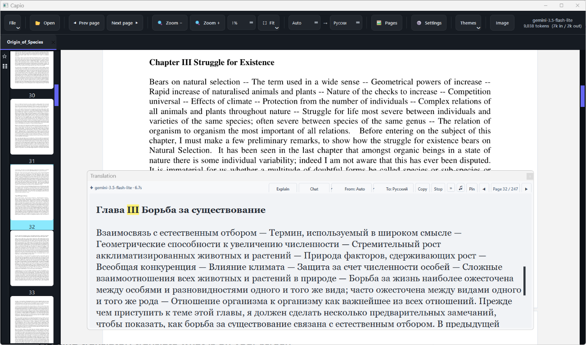
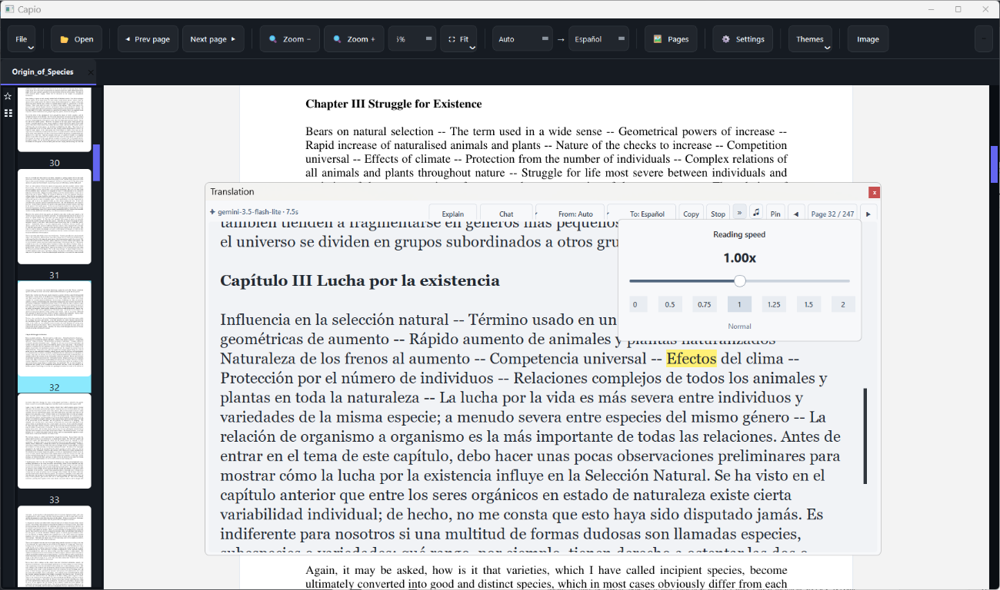
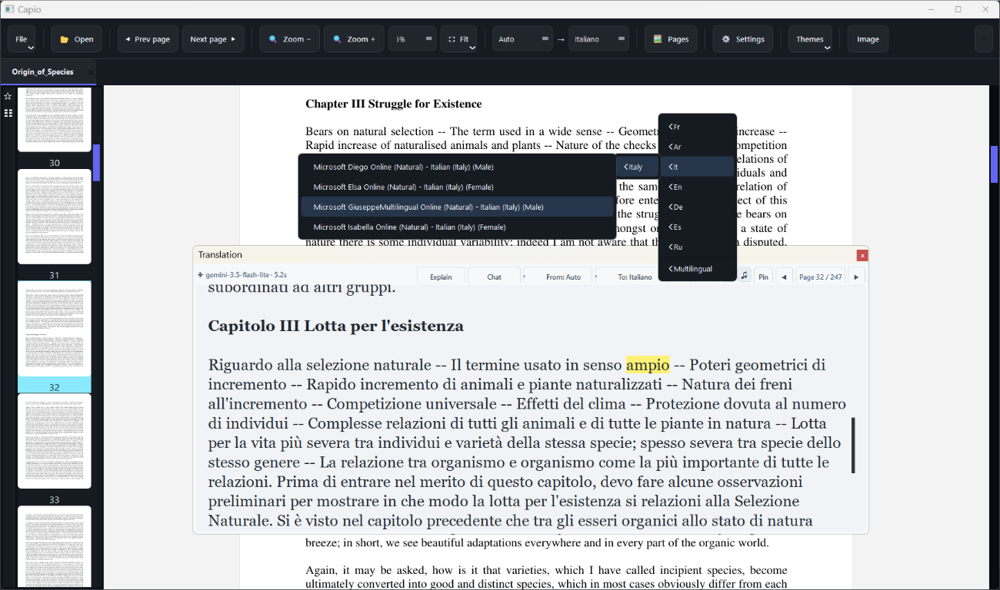
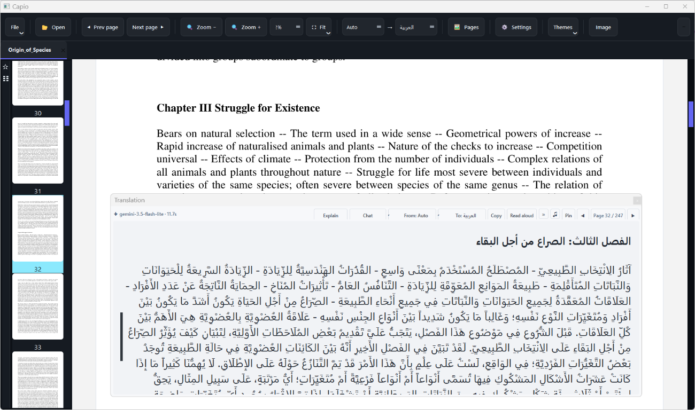
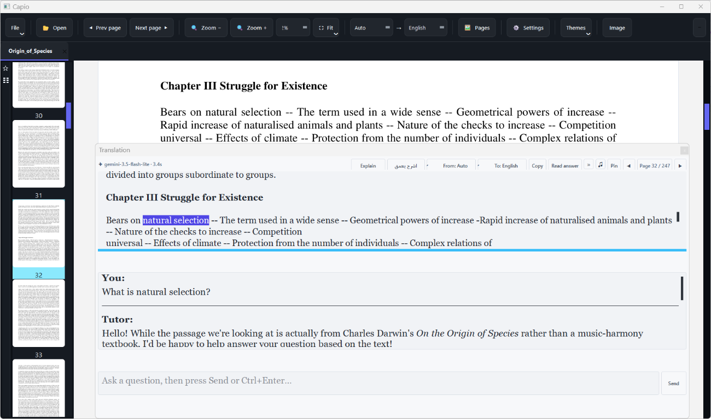

# Capio

**Current version: V1.0.6** — also shown at the bottom of Settings.

**Translate. Understand. Listen.**
Your AI reading companion, right inside your book.

Translate books, understand difficult passages, and listen to translations
without leaving your reading experience. Use the floating translator to
translate selected text and images elsewhere on your screen.

## See Capio in action

<table>
  <tr>
    <td></td>
    <td></td>
  </tr>
  <tr>
    <td align="center">Read the Russian translation beside the original page.</td>
    <td align="center">Switch to Italian while keeping your place.</td>
  </tr>
  <tr>
    <td></td>
    <td></td>
  </tr>
  <tr>
    <td align="center">Follow the original as you read the Spanish translation.</td>
    <td align="center">Read an Arabic translation alongside the book.</td>
  </tr>
  <tr>
    <td></td>
    <td></td>
  </tr>
  <tr>
    <td align="center">Ask follow-up questions about the passage without leaving the reader.</td>
    <td></td>
  </tr>
</table>

Capio keeps the translated passage beside the page, so you can continue
reading without switching applications.

## Floating translator: translate what is on your screen

Keep the floating button available over other applications, select an area,
then translate its text with OCR or send the image to a vision-capable model.

## What you can do

- Translate a word, passage, or full page beside the original.
- Read scanned pages with OCR, or send an image to a vision-capable model.
- Ask AI to explain difficult passages.
- Listen to translations and follow word-by-word highlighting; resume where you
  stopped.
- With Edge TTS and Fast mode, Capio prepares completed translations and the
  next translated page in the background for quicker **Read aloud** playback.
  Prefetch never starts playback by itself.
- Uncached speech starts streaming before synthesis finishes. Continuous reads
  avoid artificial short segments, and completed audio can be reused to jump
  to a clicked word without requesting the same speech again.
- Chat Read aloud also uses one continuous Edge TTS response, avoiding the
  short-segment transition after the first few words while preserving pause,
  resume and word seeking through the completed audio.
- Arabic reading speed is saved independently from the shared speed for other
  languages, and can be changed during playback.
- Volume and mute are controlled by the user in Windows. Neither the reader
  nor the floating translator saves, restores or forces a playback volume.
- Playback files are released automatically after use, with background retries
  for locked files and recovery of abandoned audio sessions after a crash.
  The speech cache expires unused entries after 24 hours. It is checked on
  every cache write: at 60 MiB, older entries are removed toward 48 MiB,
  with a 64 MiB ceiling and a 200-file cap. Background cleanup also runs
  once a minute.
- Translate pages and continue through a book with automatic page-by-page
  reading.
- Use the floating translator outside the book reader.
- Open PDF, EPUB, DOCX, TXT, Markdown, HTML, XPS/OXPS, FB2, CBZ, and common
  image files.

For hands-free listening, start automatic page reading from the translation
window's page counter, or right-click a page and choose **Successive reading**
to open its translation and start reading automatically. In **Settings → Read
Aloud / TTS**, enable **Translate the next page while reading** to prepare each
following page in the background.
Capio requests the next translation shortly after reading starts, while the
current speech is still being prepared or played. With Edge TTS and **Fast
mode**, it also prepares the next page's audio in the background. A completed
page advances once and the next page starts at its first word. Natural audio
completion does not restart the final words when highlighting timestamps drift.
Prepared audio reduces the pause between pages; network, OCR and translation
delays can still cause a gap when the next page is not ready.
Save the setting with **Save Changes**; it is remembered the next time you open
Capio. You can also enable **Stop successive reading after a set time** and
choose a duration in 15-minute steps up to four hours, or enter a custom
duration in minutes. Custom values are shown as hours and minutes (for example,
70 minutes becomes 1 h 10 min). When the limit is reached, Capio stops the
automatic sequence and current speech.

## I want to use Capio

1. Install **Python 3.10 or newer** on Windows.
2. Download and extract the project.
3. Double-click `run.bat` for the book reader or `run_float.bat` for the floating translator.

Both launchers start their setup terminal minimized on the taskbar. It closes
after starting the app. Configured installations launch directly from their
local Python environment, avoiding repeated system-Python discovery and a
second full import of the app's dependencies. First-time setup and changed
requirements still use the installation checks.

On first launch, Capio downloads the required libraries. Translation providers
may require an API key.

Your API keys and preferences are stored in your Windows user folder, outside
the project. If Capio cannot safely read its settings, it reports the problem
instead of starting with defaults that could overwrite your saved settings.

- [Installation and everyday use](USER_GUIDE.md)
- [Why Capio?](WHY_CAPIO.md)
- [Advanced Setup](ADVANCED_SETUP.md)

## I am a developer

- [Project layout, tests, performance notes, and packaging](DEVELOPMENT.md)
- [Provider and model integration details](ADVANCED_SETUP.md#translation-providers-api-keys-are-optional)

## License

Capio is licensed under the [MIT License](LICENSE).

## Search tags

**Reading:** #AIReadingAssistant #BookTranslation #PDFReader #EPUBReader
#DocumentTranslation #StudyTools

**Translation:** #AITranslation #OCR #VisionAI #ScreenTranslation
#FloatingTranslator #LanguageLearning

**Listening:** #TextToSpeech #TTS #ReadAloud #WordHighlighting

**Platform:** #Python #WindowsApp #OpenSource
